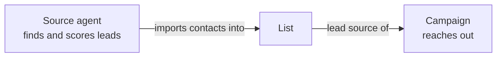

Gojiberry runs your outreach as a pipeline of three building blocks.

## The three building blocks

<Steps>
  <Step title="Source agent: the lead finder">
    A source agent continuously sources leads matching your targeting criteria (job titles, industries, locations, signals, ...) and scores them with AI.
  </Step>
  <Step title="List: where the leads land">
    Every source agent is linked to a list (`listId` is required when creating an agent): the leads it finds are imported as contacts into that list. You can also fill a list yourself, by importing contacts or revealing leads from the Directory.
  </Step>
  <Step title="Campaign: the outreach">
    A campaign uses one or more lists as its lead source (`listIds` is required when creating a campaign). It runs its steps (LinkedIn invitations, messages, emails, ...) on the contacts of those lists, sending through your LinkedIn and email seats. Once activated, it runs the outreach automatically every day.
  </Step>
</Steps>

## Terminology

| Term | Meaning |
| --- | --- |
| **Agent** | In the Gojiberry app, an Agent is a _campaign agent_: the campaign that performs the outreach. |
| **Source agent** | The lead finder that sources the leads. |
| **List** | The link between the two: the source agent imports leads into it, and the campaign agent reaches out to its contacts. |
| **Full Cycle agent** | A list, a source agent, and a campaign agent working together: leads are sourced and contacted automatically, end to end. |
| **Legacy agent** | A source agent with no campaign agent. It only sources leads and does **no outreach**. |

## Best practice: create a Full Cycle agent

Always create the three resources, in this order: first the list, then the source agent that fills it, then the campaign that reaches out to it. A source agent created without a campaign shows up as a legacy agent in the app and contacts nobody.

A typical setup through the API, with the matching [MCP](/mcp-server) tools:

| Step | API call | MCP tool |
| --- | --- | --- |
| 1. Create the list | `POST /v1/list` | `create_list` |
| 2. Create the source agent, linked to the list (`listId`) | `POST /v1/agent` | `create_agent` |
| 3. Create the campaign, using the list as lead source (`listIds`) | `POST /v1/campaign` | `create_campaign` |
| 4. Activate the campaign | `PATCH /v1/campaign/{id}/status` | `activate_campaign` |
| 5. Follow the outreach | `GET /v1/campaign/{id}/logs` | `get_campaign_logs` |

<Note>
  A new campaign starts active unless you pass `"active": false`. Create it inactive if you want to review it before anything is sent.
</Note>

The full walkthrough, with request bodies, is the [A full outbound play from one prompt](/tutorials/full-outbound-play) tutorial.
